# Critical Comparison: Audit Findings (Our Audit vs. Alternative AI Audit)

> **Auditor's Mission:** We compare our findings (derived from directly inspecting the cloned source trees of **Moodle**, **Canvas LMS**, and **Gibbon Edu**) against the alternative AI audit. We evaluate each finding with an adversarial, hyper-critical engineering mindset against the ground truth of the Classroom OS codebase.

---

## 1. Executive Comparison Scorecard

```mermaid
flowchart TD
    subgraph Agreement["1. Attendance: Dispute-Cascade Data Loss Bug"]
        A1["Both Audits Agree 100%"]
        A2["tx.delete(dailyAttendance) wipes linked disputes due to cascade"]
        A3["Fix: Atomic Drizzle onConflictDoUpdate"]
        A1 --- A2 --- A3
    end

    subgraph OtherAICredit["2. Routine: Conflict Blindspots & N+1 Writes"]
        R1["Alternative AI Found Real Code Bugs in routine-actions.ts"]
        R2["Blindspot: customTitle slots skip semester overlap check"]
        R3["Un-transactioned 14-day session delete loop"]
        R4["Broken legacy email join instead of students.userId = users.id"]
        R1 --- R2 --- R3 --- R4
    end

    subgraph Disagreement["3. Homework: The Digital Upload Debate"]
        H1["Alternative AI: Delete fileUrl & eliminate all digital uploads"]
        H2["Our Audit: PRESERVE fileUrl, but harden against 403s & tampering"]
        H3["Verdict: Alternative AI is WRONG. User specifically uses Google Drive!"]
        H1 --- H2 --- H3
    end
```



| Domain | **Alternative AI Findings** | **Our Open-Source Grounded Audit** | **Critical Assessment & Ground Truth** |
| :--- | :--- | :--- | :--- |
| **Attendance** | Found cascade-delete bug in `daily.ts#L150` wiping `attendanceCorrectionRequests`. | Found identical cascade-delete bug in `daily.ts#L150` via Gibbon/Canvas upsert analysis. | **100% Concordance (Critical Fix).** Both audits independently verified this data-loss bug. |
| **Routine Collisions** | Uncovered that `checkOverlap` skips semester checks when `subjectId` is null (`customTitle` slots). | Uncovered N+1 memory bloat in `telegram-brief-service.ts` pulling all semesters into JS memory. | **Complementary Strengths.** The other AI caught 3 genuine bugs in `routine-actions.ts`; we caught the DB query leak in Telegram services. |
| **Homework & Files** | Advocated **purging all digital upload logic (`fileUrl`, `fileName`)** as "dead scaffolding". | Advocated **hardening Google Drive handling** with pre-flight permission checks & in-app previews. | **Alternative AI is WRONG.** Deleting digital uploads would destroy the user's explicit Google Drive workflow! |
| **Absence Margins** | Did not analyze attendance calculations. | Uncovered that the 80% TU rule is purely reactive and proposed a predictive "Absence Budget". | **Our Value-Add.** Canvas/Gibbon predictive absence margin model. |

---

## 2. Deep Dive: Where Both Audits Agree (Critical Bug #1)

### The Attendance Dispute-Cascade Data Loss Bug
* **Location:** [`src/features/attendance/actions/daily.ts#L149-L171`](file:///d:/CLASSROOM%20OS/src/features/attendance/actions/daily.ts#L149-L171)
* **The Vulnerability:**
  When editing attendance for a previous date, Classroom OS executes:
  ```typescript
  await tx.delete(dailyAttendance).where(eq(dailyAttendance.dailySessionId, sessionId));
  ```
  Followed by inserting new records with new UUIDs (`da_${crypto.randomUUID()}`).
* **The Catastrophic Consequence:**
  In [`src/db/schema.ts#L455-L457`](file:///d:/CLASSROOM%20OS/src/db/schema.ts#L455-L457), `attendanceCorrectionRequests.attendanceId` foreign-keys to `daily_attendance.id` with `onDelete: "cascade"`. Calling `tx.delete(dailyAttendance)` **instantly and permanently deletes all student dispute requests and teacher audit trails for that day**!
* **The Consensus Solution:**
  Replace the delete-and-reinsert pattern with an atomic batch `onConflictDoUpdate` targeting `[dailyAttendance.dailySessionId, dailyAttendance.studentId]`.

---

## 3. Deep Dive: Valid Vulnerabilities Uncovered by Alternative AI (Critical Bug #2)

We inspected [`src/features/routine/actions/routine-actions.ts`](file:///d:/CLASSROOM%20OS/src/features/routine/actions/routine-actions.ts) line-by-line to verify the other AI's claims. **All three claims are 100% verified real bugs in our codebase:**

### Bug 2.1: The Custom Title Overlap Blindspot ([`routine-actions.ts#L60-L77`](file:///d:/CLASSROOM%20OS/scratch/canvas-lms/app/views/gradebooks/speed_grader.html.erb))
```typescript
const newSubject = subjectId ? await db.query.subjects.findFirst({ where: eq(subjects.id, subjectId) }) : null;
// ...
// 3. Semester + section overlap
if (newSubject?.semester && r.subject?.semester && areSemestersEqual(newSubject.semester, r.subject.semester) && (r.section === section)) {
   return { reason: `Semester ${newSubject.semester} (Section ${section}) already has ${r.subject.name} scheduled at this time` };
}
```
* **The Flaw:** If a slot is scheduled as an ECA, BREAK, or LAB with a `customTitle` (and no `subjectId`), `newSubject` is `null`. The condition `if (newSubject?.semester && ...)` evaluates to `false`.
* **Impact:** Two different classes or activities can be scheduled at the exact same hour in the exact same section without the overlap checker throwing an error!

### Bug 2.2: Un-Transactioned 14-Day Session Delete Loop ([`routine-actions.ts#L160-L196`](file:///d:/CLASSROOM%20OS/src/features/routine/actions/routine-actions.ts#L160-L196))
* **The Flaw:** `syncSessionsForRoutine` deletes 14 days of sessions with `await db.delete(classSessions)` and then runs an un-transactioned `for` loop inserting replacement sessions one by one.
* **Impact:** If a network blip or constraint failure occurs halfway through, the schedule is left permanently half-deleted.

### Bug 2.3: Broken Legacy Email Join ([`routine-actions.ts#L106-L111`](file:///d:/CLASSROOM%20OS/src/features/routine/actions/routine-actions.ts#L106-L111))
```typescript
const enrolledUsers = await db
  .selectDistinct({ userId: users.id })
  .from(enrollments)
  .innerJoin(students, eq(students.id, enrollments.studentId))
  .innerJoin(users, eq(users.email, students.email)) // ⚠️ Legacy join
  .where(eq(enrollments.subjectId, subjectId));
```
* **The Flaw:** Milestone 7 normalized `students.userId` as a direct 1:1 foreign key to `users.id`. Joining on `users.email = students.email` is an outdated legacy anti-pattern. If a student changes their email, routine notifications fail silently.

---

## 4. Deep Dive: Where the Alternative AI is DANGEROUSLY WRONG (Critical Bug #3)

### The Homework Digital Upload Controversy
* **The Alternative AI's Recommendation:**
  > *"Eliminating Legacy Digital Upload Scaffolding: In accordance with LEARNINGS.md, CLASSROOM OS uses the Nepal Physical Notebook Diary model. Clean up dead digital upload parameters (`fileUrl`, `fileName`, `fileSize`) and incomplete upload branches."*

### Why the Alternative AI's Recommendation Must Be REJECTED:
1. **Contradicts Real User Requirements:**
   The user explicitly stated in this session:
   > *"i need for attendance homework sharing how are they doing it we are using google drive"*
   The user's college **actively uses Google Drive** for programming lab reports, slide presentations, and shared documents!
2. **Misinterpreting the Physical Notebook Invariant:**
   `LEARNINGS.md` introduced "Completed in Notebook" to provide a **frictionless alternative to mandatory PDF scanning** for handwritten math/theory homework. It was **never intended to strip away digital file sharing or Google Drive links** when an assignment requires submitting code or a digital report!
3. **The Real Problem is URL Fragility, Not the Presence of URLs:**
   Purging `fileUrl` would break Google Drive submissions entirely. What Classroom OS actually needs is **Canvas-style hardening**:
   * Pre-flight probe Google Drive URLs to prevent 403 "Request Access" blocks.
   * Embed in-app previews via [`FilePreview`](file:///d:/CLASSROOM%20OS/src/components/files/file-preview.tsx) instead of kicking students to external tabs.
   * Prevent post-deadline tampering.

---

## 5. Unified Synthesis: The Master Hardening Plan

By combining the valid findings from both audits, we establish a comprehensive, zero-regression hardening roadmap for Classroom OS:

### Part A: Attendance Hardening
* [ ] **Fix Cascade-Delete in `daily.ts`:** Refactor [`submitDailyAttendanceAction`](file:///d:/CLASSROOM%20OS/src/features/attendance/actions/daily.ts) to use atomic Drizzle `onConflictDoUpdate` targeting `[dailyAttendance.dailySessionId, dailyAttendance.studentId]`.
* [ ] **Add Predictive Absence Budget:** Upgrade [`src/features/attendance/calculations/`](file:///d:/CLASSROOM%20OS/src/features/attendance/calculations/) to compute remaining allowable absences before the 80% TU exam barrier is breached.

### Part B: Routine Hardening
* [ ] **Fix Custom Title Overlap Blindspot:** In [`routine-actions.ts#L63`](file:///d:/CLASSROOM%20OS/src/features/routine/actions/routine-actions.ts#L63), pass the `semester` explicitly so non-subject slots (`ECA`, `LAB`, `BREAK`) are checked against the section's semester.
* [ ] **Wrap `syncSessionsForRoutine` in an Atomic Transaction:** Ensure the 14-day delete-and-insert operates inside `await db.transaction(...)`.
* [ ] **Fix Foreign Key Join in `notifyEnrolledStudents`:** Replace `users.email = students.email` with `innerJoin(users, eq(users.id, students.userId))`.
* [ ] **Optimize Telegram Brief SQL Query:** In [`telegram-brief-service.ts`](file:///d:/CLASSROOM%20OS/src/features/telegram/services/telegram-brief-service.ts), push the semester/section filter into SQL `innerJoin(subjects)` rather than filtering in JavaScript memory.

### Part C: Homework & Google Drive Hardening
* [ ] **Preserve Both Notebook & Digital Workflows:** Retain `toggleHomeworkCompletionAction` for physical notebooks while keeping `fileUrl` for Google Drive.
* [ ] **Add Pre-Flight Google Drive Validation:** Warn students immediately if a pasted Drive link is restricted/private before they submit.
* [ ] **In-App Google Drive Preview:** Render [`FilePreview`](file:///d:/CLASSROOM%20OS/src/components/files/file-preview.tsx) directly inside [`homework-detail-client.tsx`](file:///d:/CLASSROOM%20OS/src/features/assignments/components/homework-detail-client.tsx).
