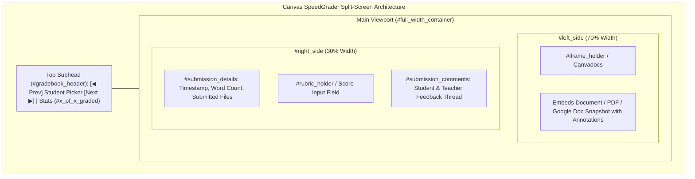
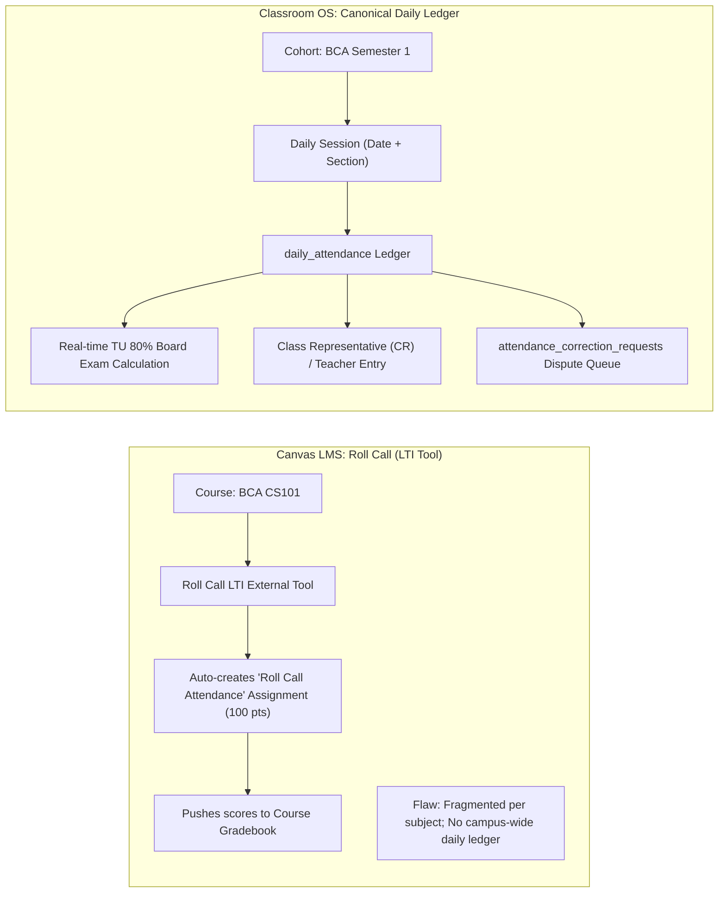

# Open-Source Audit Findings: Canvas LMS (instructure/canvas-lms)

> **Evaluated Repository:** [`instructure/canvas-lms`](https://github.com/instructure/canvas-lms) (Cloned & Inspected directly at `scratch/canvas-lms`)  
> **Repository Location:** Saved to project research file at [`docs/research/canvas-lms-findings.md`](file:///d:/CLASSROOM%20OS/docs/research/canvas-lms-findings.md)  
> **Compared Against:** [Classroom OS](file:///d:/CLASSROOM%20OS) (`CLASSROOM OS`)

---

## 1. Direct Codebase Inspection & Verified File Locations

Following a clone of the official `instructure/canvas-lms` repository, we inspected the live production codebase to verify its design patterns:

| Canvas Subsystem | Exact Inspected File Path | Implementation Reality |
| :--- | :--- | :--- |
| **SpeedGrader Layout** | [`app/views/gradebooks/speed_grader.html.erb#L39-L220`](file:///d:/CLASSROOM%20OS/scratch/canvas-lms/app/views/gradebooks/speed_grader.html.erb) | Full-viewport split-screen (`#left_side` at 70% with `#iframe_holder`, `#right_side` at 30% with `#submission_details`, rubric holder, and stats bar `#x_of_x_graded`). |
| **SpeedGrader TypeScript** | [`ui/features/speed_grader/jquery/speed_grader.utils.tsx#L49-L100`](file:///d:/CLASSROOM%20OS/scratch/canvas-lms/ui/features/speed_grader/jquery/speed_grader.utils.tsx) | Client-side React mount points (`SpeedGraderPostGradesMenu`, `SpeedGraderSettingsMenu`, `speed_grader_comment_textarea_mount_point`). Pre-batches student data in memory. |
| **Google Drive ACLs** | [`app/models/google_docs_collaboration.rb#L60-L105`](file:///d:/CLASSROOM%20OS/scratch/canvas-lms/app/models/google_docs_collaboration.rb) | Programmatic Google Drive permission management via `google_drive_for_user.acl_add(document_id, user_ids)` and `acl_remove`. |
| **Submission Model** | [`app/models/submission.rb#L141-L495`](file:///d:/CLASSROOM%20OS/scratch/canvas-lms/app/models/submission.rb) | Handles URL submissions by generating a screenshot/snapshot attachment (`belongs_to :attachment`) and streaming files to Canvadocs (`after_save :submit_attachments_to_canvadocs`). |
| **Linked Attachments** | [`lib/linked_attachment_handler.rb#L29-L48`](file:///d:/CLASSROOM%20OS/scratch/canvas-lms/lib/linked_attachment_handler.rb) | Tracks file associations and restricts cross-course sharing to prevent unauthorized access across cohorts. |

---

## 2. SpeedGrader Deep-Dive: Why It Is 10x Faster

In `speed_grader.html.erb`:
* **Zero-Reload Student Switching:** The student switcher buttons (`#prev-student-button`, `#next-student-button`) load student records asynchronously without full page navigation.
* **In-App Annotation (`#left_side`):** Submissions render in an embedded iframe (`#iframe_holder`) powered by Canvadocs. Teachers never download student files to their desktop.
* **Integrated Rubrics (`#rubric_full`):** Renders criteria checkboxes and score sliders directly adjacent to the student's work.

---

## 3. Attendance Comparison: Canvas Roll Call vs. Classroom OS

* **Canvas LMS ("Roll Call Attendance"):** An external LTI tool that creates a dummy 100-point assignment in the course gradebook. Just like Moodle, it is **course-siloed**—every teacher must separately take attendance in their own subject, and campus administrators cannot view overall daily student attendance.
* **Classroom OS Advantage:** Our [daily attendance ledger](file:///d:/CLASSROOM%20OS/src/db/schema.ts#L918-L929) takes **one entry per day** for the entire cohort, calculates the strict **80% TU Exam Eligibility Rule**, and allows student Class Representatives (`CR`) to assist with morning roll call.

---

## 4. Google Drive & File Handling: The Canvas Lesson

From inspecting `app/models/submission.rb` (line 141) and `google_docs_collaboration.rb`:
* **Canvas Principle:** *Never rely on raw Google Drive links.*
  1. Canvas manages Google Drive ACLs directly via Google API client libraries (`acl_add`).
  2. For URL/external submissions, Canvas takes a snapshot attachment (`belongs_to :attachment # screenshot/snapshot of URL submission`).
  3. Files are converted into Canvadocs/PDF format so instructors can view and annotate them without needing personal Google editing rights.
* **Classroom OS Vulnerability:** Classroom OS currently stores raw URL strings in [`assignment_submissions.fileUrl`](file:///d:/CLASSROOM%20OS/src/db/schema.ts#L293). If a student pastes a restricted link, the teacher is locked out with a 403 error. If a student edits a document after the deadline, there is no audit snapshot.

---

## 5. What Classroom OS Has That Canvas LMS Lacks

1. **Campus Weekly Routine Noticeboard Matrix:** Canvas has an event calendar, but cannot model physical recurring college periods, room allocations, lunch breaks, or back-to-back merged double periods.
2. **Physical Notebook Homework Flow:** Canvas assumes 100% digital homework; Classroom OS supports the physical reality of student notebooks (`Completed in notebook`) with teacher dispute queues.
3. **Class Representative (CR) Role:** Canvas has Teacher, TA, Student, and Observer, but no student peer-delegate for classroom management.
4. **Missed Day Catch-Up Journal:** Unified feed showing absent students what was taught and what homework was given across all subjects on their absence dates.
5. **Native Telegram Bot Broadcasts:** Cron-driven 05:30 morning routine briefs, 20:00 evening homework recaps, and real-time timetable change publishing.
6. **Bikram Sambat (BS) Dual Calendar:** Support for Nepali calendar dates and NPT timezone boundaries.

---

## 6. Concrete Upgrades for Classroom OS Inspired by Canvas Codebase

### Upgrade 1: Build the Classroom OS SpeedGrader Drawer
Replicate Canvas's `#full_width_container` pattern ([`speed_grader.html.erb#L106`](file:///d:/CLASSROOM%20OS/scratch/canvas-lms/app/views/gradebooks/speed_grader.html.erb#L106)) in React 19:
* Create `src/features/assignments/components/SpeedGraderDrawer.tsx`.
* Left pane (65%): In-app `/preview` iframe for Google Drive / PDFs, or a high-contrast banner for "Completed in Physical Notebook".
* Right pane (35%): Score input, status selector (`Graded`, `Needs Revision`), quick feedback chips, and `J`/`K` hotkeys to cycle students.

### Upgrade 2: Pre-Flight Google Drive Link Validation
* When a student enters a Google Drive link, immediately run a pre-flight probe against Google's public thumbnail API to verify that sharing permissions are not set to "Private/Restricted".

### Upgrade 3: Submission Snapshotting
* Mirror Canvas's `belongs_to :attachment` pattern for URL submissions: fetch an immutable PDF snapshot of public Google Docs at the deadline, storing it in our [`files`](file:///d:/CLASSROOM%20OS/src/db/schema.ts#L499-L525) table so students cannot alter their work post-deadline.
