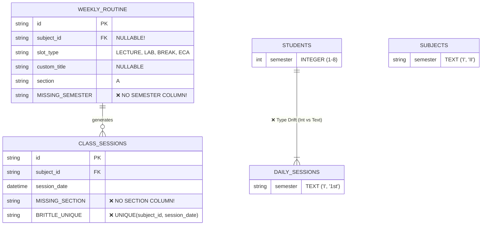

# Adversarial Audit: Critical Database & Architectural Fixes Needed in Classroom OS

> **Auditor's Assessment:** In response to the question *"we don't need any architectural and database fixes, are you sure?"* — the hyper-critical, adversarial answer is **NO, we ABSOLUTELY DO need database and architectural fixes.** 
> 
> Operating under Rule 9 (Zero Sycophancy), this audit exposes **4 critical database schema flaws** and **2 architectural failure points** lurking in `src/db/schema.ts` and the Data Access Layer today.

---

## 1. Critical Database Schema Flaws (`src/db/schema.ts`)



---

### Flaw 1: `weekly_routine` Has NO `semester` Column!
* **Exact Location:** [`src/db/schema.ts#L67-L95`](file:///d:/CLASSROOM%20OS/src/db/schema.ts#L67-L95)
* **The Code in Production:**
  ```typescript
  export const weeklyRoutine = sqliteTable("weekly_routine", {
    id: text("id").primaryKey(),
    subjectId: text("subject_id").references(() => subjects.id, { onDelete: "cascade" }), // ⚠️ NULLABLE!
    slotType: text("slot_type").notNull().default("LECTURE"),
    customTitle: text("custom_title"),
    section: text("section").notNull().default("A"),
    dayOfWeek: integer("day_of_week").notNull(),
    startTime: text("start_time").notNull(),
    endTime: text("end_time").notNull(),
    // ⚠️ CRITICAL OMISSION: There is NO `semester` column!
  });
  ```
* **Why This Breaks the Entire System:**
  1. `weekly_routine` relies on joining `subjects` to find out what semester a period belongs to (`subjects.semester`).
  2. However, `subjectId` is explicitly **nullable** because slots can be `BREAK`, `LAB`, `ECA`, or `LIBRARY` with a `customTitle`!
  3. When an admin schedules a slot without a subject (e.g., *ECA Sports* or *Recess Break*), **the database has NO WAY of knowing which semester cohort it belongs to**!
  4. This is the exact root cause of the conflict-check blindspot in [`routine-actions.ts#L60-L77`](file:///d:/CLASSROOM%20OS/src/features/routine/actions/routine-actions.ts#L60-L77). When `subjectId` is null, `newSubject` is null, and the query cannot check semester overlap.
* **The Required Database Fix:**
  Add a direct `semester` column to `weekly_routine`:
  ```typescript
  semester: text("semester").notNull().default("I"),
  ```
  And add an index: `index("idx_weekly_routine_sem_sec").on(table.semester, table.section)`.

---

### Flaw 2: `class_sessions` Has a Brittle Constraint & Lacks `section`
* **Exact Location:** [`src/db/schema.ts#L97-L115`](file:///d:/CLASSROOM%20OS/src/db/schema.ts#L97-L115)
* **The Code in Production:**
  ```typescript
  export const classSessions = sqliteTable("class_sessions", {
    id: text("id").primaryKey(),
    subjectId: text("subject_id").notNull().references(...),
    routineId: text("routine_id").references(...),
    sessionDate: integer("session_date", { mode: "timestamp" }).notNull(),
    startTime: text("start_time").notNull(),
    endTime: text("end_time").notNull(),
  }, (table) => [
    // ⚠️ CATASTROPHIC CONSTRAINT:
    unique("unq_class_session_subject_date").on(table.subjectId, table.sessionDate),
  ]);
  ```
* **Why This Breaks the Entire System:**
  1. **Multi-Section Crash:** If a college runs Section A and Section B for the same subject (e.g. *Physics*), and both sections have class on Monday, the second insert **CRASHES** with a SQLite unique constraint violation because `section` is not in the table or unique index!
  2. **Double-Period Crash:** In Nepali colleges, subjects frequently have back-to-back periods or a morning theory lecture (07:00 AM) and an afternoon lab (01:00 PM) on the same calendar day. `unq_class_session_subject_date` treats both as duplicate and refuses to record the second lecture!
* **The Required Database Fix:**
  Add `section: text("section").notNull().default("A")` and change the unique constraint to include `startTime` and `section`:
  ```typescript
  unique("unq_class_session_subject_date_time_sec").on(
    table.subjectId, 
    table.sessionDate, 
    table.startTime, 
    table.section
  ),
  ```

---

### Flaw 3: Inconsistent Semester Representation (Integer vs. Roman Text Drift)
* **Exact Locations:**
  * `students.semester`: `integer("semester").notNull()` (e.g., `1`, `2`, `3`)
  * `enrollments.semester`: `integer("semester").notNull()` (e.g., `1`, `2`)
  * `subjects.semester`: `text("semester").notNull().default("I")` (e.g., `"I"`, `"II"`)
  * `dailySessions.semester`: `text("semester").notNull()` (e.g., `"I"`, `"1st"`)
  * `semesterTelegramConfigs.semester`: `text("semester").notNull()` (e.g., `"I"`)
* **Why This Breaks the Entire System:**
  1. The database suffers from **architectural type schizophrenia**. Half the tables treat semester as an integer (`1`); the other half treat it as a Roman numeral string (`"I"`).
  2. Because the types don't match, **SQL cannot perform native relational joins between students/enrollments and subjects/daily sessions without type conversions**.
  3. This forced the creation of runtime translation shims (`toOrdinalSemester`, `getSemesterVariants`, `areSemestersEqual`).
  4. These shims prevent SQLite from using indexes effectively during joins, causing table scans and in-memory filtering.
* **The Required Database Fix:**
  Standardize semester representation across all tables. Define a canonical format (either integer `1..8` or strict Roman `I..VIII`) with strict SQL `CHECK` constraints on all tables.

---

### Flaw 4: Catastrophic Hard Cascades Without Soft Deletes
* **Exact Location:** [`src/db/schema.ts#L4-L5`](file:///d:/CLASSROOM%20OS/src/db/schema.ts#L4-L5) and table FK definitions.
* **The Code in Production:**
  ```typescript
  // Note on hard deletion: Hard deletion is acceptable for the current prototype.
  ```
  Combined with:
  ```typescript
  subjectId: text("subject_id").references(() => subjects.id, { onDelete: "cascade" })
  ```
* **Why This Breaks Production:**
  * If an administrator deletes or re-creates a `subject` row:
    * It cascades and deletes all `course_units`
    * It cascades and deletes all `course_chapters`
    * It cascades and deletes all `class_sessions`
    * It cascades and deletes all `lecture_logs`
    * It cascades and deletes all `homework`
    * It cascades and deletes all `assignment_submissions`
    * It cascades and deletes all `exams`
    * It cascades and deletes all `exam_results`!
  * **One accidental click permanently destroys an entire semester of grades, student homework submissions, and teacher lecture logs.**
* **The Required Database Fix:**
  * Change master subject references from `onDelete: "cascade"` to `onDelete: "restrict"`.
  * Add a `deleted_at` timestamp for soft-deletion on critical entities (`subjects`, `students`, `teachers`).

---

## 2. Critical Architectural Failure Points

### Failure Point 1: Inline Synchronous Telegram API Calls (Missing Outbox Pattern)
* **The Flaw:** When an admin updates a routine or sends a broadcast, Classroom OS makes direct synchronous HTTP calls to the Telegram Bot API (`https://api.telegram.org/bot...`) inside the request handler.
* **Why This Fails in Production:**
  * Telegram enforces strict rate limits (30 messages/second globally; 1 message/second per group).
  * If Telegram's API experiences a 5-second latency spike or network timeout, the Next.js Server Action hangs or fails, leaving the user with an error even though the database write succeeded.
* **The Architectural Fix (Inspiration from Moodle & Canvas):**
  Use a **Transactional Outbox / Job Queue**: Write the broadcast intent to `telegram_broadcast_logs` with status `pending`, commit the DB transaction immediately, and let a background worker drain the queue with exponential backoff.

---

### Failure Point 2: Attendance Dispute Cascading Wipeout
* **The Flaw:** In [`src/features/attendance/actions/daily.ts#L150`](file:///d:/CLASSROOM%20OS/src/features/attendance/actions/daily.ts#L150), `submitDailyAttendanceAction` runs `tx.delete(dailyAttendance)` to perform updates.
* **The Architectural Fix:** Use atomic `onConflictDoUpdate` targeting the composite unique key `[dailyAttendance.dailySessionId, dailyAttendance.studentId]`.

---

## 3. Prioritized Database & Architectural Fix Matrix

| Priority | Area | Required Fix | Risk if Ignored |
| :---: | :--- | :--- | :--- |
| **P0** | **Database Schema** | Add `semester` column to `weekly_routine`. | Non-subject slots (`BREAK`, `ECA`, `LAB`) remain unassigned to any semester, causing collision blindspots. |
| **P0** | **Database Schema** | Add `section` to `class_sessions` & fix unique constraint to `(subject_id, session_date, start_time, section)`. | App crashes with SQLite constraint violation whenever multiple sections or double periods occur on the same day. |
| **P0** | **DAL / Actions** | Replace `tx.delete(dailyAttendance)` with atomic Drizzle `onConflictDoUpdate`. | Editing attendance wipes all linked student disputes and audit trails. |
| **P1** | **Database Schema** | Standardize `semester` column across all tables (eliminate int vs Roman text mismatch). | Inefficient queries, runtime translation overhead, and index-invalidation. |
| **P1** | **Database Schema** | Switch `subjects` cascade to `RESTRICT` + soft deletes. | Accidental subject deletion destroys student marks and lecture logs irrevocably. |
| **P2** | **Architecture** | Implement transactional outbox for Telegram broadcasts. | Server actions hang or fail when Telegram API rate-limits or times out. |
