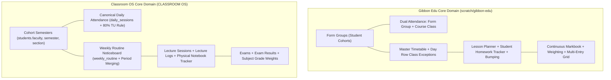

# Open-Source Audit Findings: Gibbon Edu (GibbonEdu/core)

> **Evaluated Repository:** [`GibbonEdu/core`](https://github.com/GibbonEdu/core) (Cloned & Inspected directly at `scratch/gibbon-edu`)  
> **Repository Location:** Saved to project research file at [`docs/research/gibbon-edu-findings.md`](file:///d:/CLASSROOM%20OS/docs/research/gibbon-edu-findings.md)  
> **Compared Against:** [Classroom OS](file:///d:/CLASSROOM%20OS) (`CLASSROOM OS`)  
> **Goal:** Enhance Classroom OS's existing features architecturally, logically, and technically.

---

## 1. System Overview: Why Gibbon Edu is the Closest Architectural Match

Unlike Moodle or Canvas (which were built for virtual/remote course delivery), **Gibbon Edu** is purpose-built for the day-to-day operations of physical schools and colleges:



| Architectural Dimension | **Gibbon Edu** (`GibbonEdu/core`) | **Classroom OS** (`CLASSROOM OS`) |
| :--- | :--- | :--- |
| **Target Organization** | In-person physical schools & sixth form colleges | Physical university cohorts (TU BCA / CSIT colleges) |
| **Tech Stack** | PHP 8.2+, MySQL (`gibbon.sql`), Twig/Vanilla templates | Next.js 16 App Router, React 19, TypeScript, Drizzle ORM, LibSQL/SQLite |
| **Cohort Structure** | `gibbonFormGroup` (Homeroom / Cohort) | `students.faculty`, `semester`, `section` |
| **Attendance Paradigm** | **Dual Attendance:** Form Group Daily Roll Call + Class Lesson Attendance | **Single Canonical Daily Ledger** (`daily_attendance`) decoupled from lecture logs |
| **Timetable Architecture** | Column/Row matrix with **Day Exceptions** & **Space Changes** | Weekly routine noticeboard (`weekly_routine`) with dynamic period merging |
| **Homework Tracking** | Personal completion flag (`gibbonPlannerEntryStudentTracker`) | Physical notebook completion toggle (`toggleHomeworkCompletionAction`) |
| **Assessment Model** | Continuous Markbook with batch spreadsheet entry | Institutional exam marksheets (`exams`, `exam_results`) |

---

## 2. Direct Codebase Inspection & Verified Architectural Mechanics

Inspecting `scratch/gibbon-edu/gibbon.sql` and `modules/` revealed several battle-tested patterns directly applicable to Classroom OS:

### 2.1 Attendance: The Unified Person Log (`gibbonAttendanceLogPerson`)
In [`scratch/gibbon-edu/gibbon.sql#L1013-L1029`](file:///d:/CLASSROOM%20OS/scratch/gibbon-edu/gibbon.sql#L1013-L1029):
```sql
CREATE TABLE `gibbonAttendanceLogPerson` (
  `gibbonAttendanceLogPersonID` int(14) UNSIGNED ZEROFILL NOT NULL,
  `gibbonPersonID` int(10) UNSIGNED ZEROFILL NOT NULL,
  `direction` enum('In','Out') NOT NULL,
  `type` varchar(30) NOT NULL DEFAULT '',
  `reason` varchar(30) NOT NULL DEFAULT '',
  `context` enum('Form Group','Class','Person','Future','Self Registration') DEFAULT NULL,
  `comment` varchar(255) NOT NULL,
  `date` date DEFAULT NULL,
  `timestampTaken` timestamp NULL DEFAULT NULL
);
```
* **Key Innovation:** Uses a `context` enum to store all attendance actions in a single ledger:
  * `Form Group`: Morning roll call for the cohort.
  * `Class`: Specific lecture period attendance.
  * `Future`: Pre-registered excused medical leaves or sports competition absences.

### 2.2 Timetable Exceptions & Substitutes (`gibbonTTDayRowClassException`)
In [`scratch/gibbon-edu/gibbon.sql#L6508-L6512`](file:///d:/CLASSROOM%20OS/scratch/gibbon-edu/gibbon.sql#L6508-L6512):
```sql
CREATE TABLE `gibbonTTDayRowClassException` (
  `gibbonTTDayRowClassExceptionID` int(14) UNSIGNED ZEROFILL NOT NULL,
  `gibbonTTDayRowClassID` int(12) UNSIGNED ZEROFILL NOT NULL,
  `gibbonPersonID` int(10) UNSIGNED ZEROFILL NOT NULL
);
```
And `gibbonTTSpaceChange` in line 6553:
* **Key Innovation:** When a teacher is absent or a room is undergoing maintenance, Gibbon **does not mutate the master recurring timetable**. Instead, it writes an exception row for that specific calendar date.
* **Classroom OS Current Gap:** In Classroom OS, if an admin wants to assign a substitute teacher for Wednesday Period 2, they currently have to edit the master recurring [`weekly_routine`](file:///d:/CLASSROOM%20OS/src/db/schema.ts#L67-L96) row, which unintentionally alters every future Wednesday!

### 2.3 Lesson Bumping (`modules/Planner/planner_bump.php`)
In [`modules/Planner/planner_bump.php`](file:///d:/CLASSROOM%20OS/scratch/gibbon-edu/modules/Planner/planner_bump.php):
* **Key Innovation:** When an unplanned holiday, weather closure, or college strike occurs, teachers can click **"Bump Lesson Forward"**. Gibbon shifts the lesson plan, homework deadline, and syllabus topics to the next scheduled timetable period automatically.
* **Classroom OS Current Gap:** If college is closed for a day, the missed sessions must be manually rescheduled or left blank.

### 2.4 Batch Grade Entry Spreadsheet (`modules/Markbook/markbook_edit_addMulti.php`)
* **Key Innovation:** Instead of clicking into individual student profiles to enter grades, teachers view an entire class spreadsheet where all students are listed vertically and marks are typed into keyboard-navigable inputs.

---

## 3. Four Concrete Upgrades to Make Classroom OS Ultra-Robust

Based on Gibbon Edu's production models, here is how we can harden Classroom OS's existing features:

---

### Upgrade 1: Timetable Exceptions & Substitute Teacher Assignments (Architectural)

#### The Problem
Currently, Classroom OS's [`weekly_routine`](file:///d:/CLASSROOM%20OS/src/db/schema.ts#L67-L96) represents a static weekly template (Day 0-6). If Teacher A is on sick leave today and Teacher B takes their lecture in Room 302, editing `weekly_routine` breaks next week's timetable.

#### The Gibbon-Inspired Solution
Add a lightweight `routine_exceptions` table to `src/db/schema.ts`:

```typescript
export const routineExceptions = sqliteTable("routine_exceptions", {
  id: text("id").primaryKey(),
  routineId: text("routine_id")
    .notNull()
    .references(() => weeklyRoutine.id, { onDelete: "cascade" }),
  exceptionDate: integer("exception_date", { mode: "timestamp" }).notNull(),
  type: text("type").notNull(), // 'SUBSTITUTE' | 'ROOM_CHANGE' | 'CANCELED'
  substituteTeacherId: text("substitute_teacher_id")
    .references(() => teachers.id, { onDelete: "set null" }),
  substituteRoom: text("substitute_room"),
  reason: text("reason"),
  createdAt: integer("created_at", { mode: "timestamp" }).notNull().default(sql`(unixepoch())`),
}, (table) => [
  unique("unq_routine_exception_date").on(table.routineId, table.exceptionDate),
  index("idx_routine_exceptions_date").on(table.exceptionDate),
]);
```

#### Workflow & Telegram Integration
1. Admin opens the Timetable Noticeboard $\rightarrow$ Clicks a period $\rightarrow$ Taps **"Assign Substitute for Today"**.
2. Selects substitute teacher and optional new room.
3. **Telegram Automation:** Sends an instant notification to the cohort group chat:
   > 📢 **Routine Update (Today):** *Period 2 (Computer Networks) will be taught by Prof. Sharma in Room 302 instead of Room 101.*
4. The master `weekly_routine` remains completely pristine for future weeks.

---

### Upgrade 2: Pre-Registered Leaves & Truancy Alerts (Logical)

#### The Problem
In Classroom OS, students who know they will be absent (e.g. medical appointment or university tournament) are marked "Absent" during morning roll call. They must later file an `attendance_correction_request` to fix it.

#### The Gibbon-Inspired Solution
Implement **Pre-Authorized Leave (`attendance_future_byPerson.php` pattern)**:

```typescript
export const studentLeaves = sqliteTable("student_leaves", {
  id: text("id").primaryKey(),
  studentId: text("student_id")
    .notNull()
    .references(() => students.id, { onDelete: "cascade" }),
  startDate: integer("start_date", { mode: "timestamp" }).notNull(),
  endDate: integer("end_date", { mode: "timestamp" }).notNull(),
  reason: text("reason").notNull(),
  status: text("status").notNull().default("pending"), // 'pending' | 'approved' | 'rejected'
  approvedBy: text("approved_by").references(() => users.id, { onDelete: "set null" }),
  createdAt: integer("created_at", { mode: "timestamp" }).notNull().default(sql`(unixepoch())`),
});
```

* **Morning Roll Call Integration:** When the CR or Teacher opens `TakeAttendanceCard`, any student with an approved `student_leave` for today is **automatically pre-selected as "Excused"** with a badge: `[ Approved Medical Leave ]`.
* **Consecutive Absence Detection:** When roll call is submitted, if a student has accumulated $\ge 3$ consecutive unexcused absences, flag an alert on the Admin Dashboard and dispatch a private warning to the student.

---

### Upgrade 3: Lesson Bumping for Strike/Holiday Resilience (Operational)

#### The Problem
In physical Nepali colleges, unannounced strikes, road blockages, or unexpected local holidays occur frequently. Planned lectures in `class_sessions` become desynchronized from the university calendar.

#### The Gibbon-Inspired Solution
Adopt the `planner_bump.php` flow:
* Add a **[ Bump Session Forward ]** action on `class_sessions`.
* When triggered by a Teacher or Admin for a canceled date, it queries the next scheduled timetable period for that subject and shifts the planned topics and homework due date forward by 1 period automatically.

---

### Upgrade 4: Multi-Student Batch Exam Marksheet Grid (Technical)

#### The Problem
Entering exam marks in `exam_results` currently requires submitting individual student scores or running custom scripts.

#### The Gibbon-Inspired Solution
Adopt `markbook_edit_addMulti.php`:
* Render a high-density, keyboard-accessible table for the subject exam.
* Columns: `Roll No`, `Student Name`, `Obtained Marks [Input]`, `Is Absent [Checkbox]`, `Remarks [Input]`.
* Hitting `Enter` or `ArrowDown` automatically saves the current row via Server Action and moves focus to the next student's marks input.
* Includes a **[ Export Marksheet to CSV ]** button formatted for Tribhuvan University semester submission.

---

## 4. Summary Matrix: What to Adopt from Gibbon Edu

| Gibbon Edu Pattern | Classroom OS Existing Target | Architectural Value |
| :--- | :--- | :--- |
| `gibbonTTDayRowClassException` | [`src/features/routine/`](file:///d:/CLASSROOM%20OS/src/features/routine/) | Allows substitute teachers and one-off room changes without corrupting master recurring routine. |
| `attendance_future_byPerson.php` | [`src/features/attendance/`](file:///d:/CLASSROOM%20OS/src/features/attendance/) | Pre-populates approved student leaves during morning roll call; eliminates false absence strikes. |
| `report_consecutiveAbsences.php` | [`src/features/attendance/calculations/`](file:///d:/CLASSROOM%20OS/src/features/attendance/calculations/) | Real-time truancy detection before students hit the fatal 80% TU exam barrier. |
| `planner_bump.php` | [`src/features/sessions/`](file:///d:/CLASSROOM%20OS/src/features/sessions/) | Shifts planned lecture topics forward when unexpected campus holidays occur. |
| `markbook_edit_addMulti.php` | [`src/features/subjects/`](file:///d:/CLASSROOM%20OS/src/features/subjects/) | Batch spreadsheet-style marks entry grid with keyboard navigation for teachers. |
